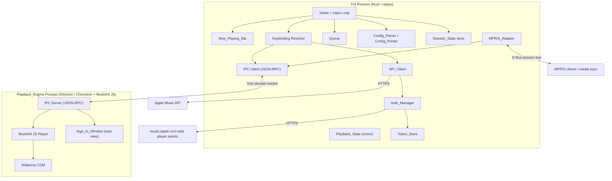
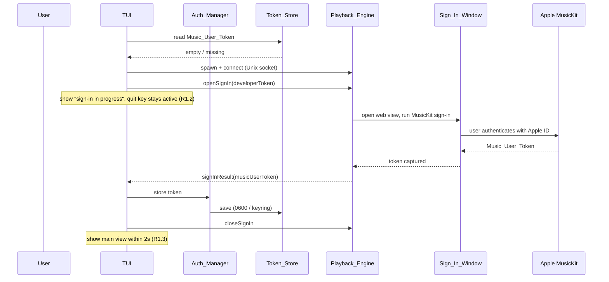

# Design Document

## Overview

Apple Music TUI is a keyboard-driven terminal application for Linux that lets an Apple Music subscriber search the catalog, browse their library, and play full-length tracks without keeping a browser open. The central design tension is that Apple Music full-length streams are DRM-protected (Widevine) and, on Linux, can only be decoded inside a Chromium-based runtime running MusicKit JS — which is memory-heavy — while the product goal (Requirement 10) is to stay lightweight.

The design resolves this tension with a **two-process architecture**:

- A **TUI process** written in Rust that owns all terminal rendering, keyboard input, application state (Queue, configuration, session), catalog/library HTTP access, and the MPRIS adapter. This process is small (< 100 MB idle, Requirement 10.2).
- A **Playback_Engine process**, an Electron/Chromium runtime that runs MusicKit JS. It performs the DRM-protected audio playback, hosts the Sign_In_Window, and captures the Music_User_Token. This is the only heavy component, and the combined budget (< 400 MB during playback, Requirement 10.3) is sized to accommodate it.

The two processes communicate over a **length-prefixed JSON-RPC channel on a Unix domain socket**. The TUI is the parent and supervisor; the Playback_Engine is a child that the TUI spawns, monitors, and tears down.

### Key Design Decisions (resolving the requirements' Open Questions)

- **Playback_Engine runtime (Open Question 1):** A headless-capable Electron/Chromium runtime with Widevine is accepted as a background dependency. It is the only known path to DRM-protected playback and the embedded MusicKit sign-in on Linux. The memory cost is isolated to this process and bounded by Requirement 10.3.
- **Memory budget (Open Question 2):** The budgets are treated as hard design targets. The TUI being native (Rust) rather than another Electron window is the primary lever that keeps idle usage under 100 MB; the Chromium process is launched with reduced features (no extra renderers, GPU disabled where possible, single audio renderer) to stay within the combined 400 MB.
- **Preview-only mode (Open Question 3):** Adopted as a fallback. When the Playback_Engine cannot start or Widevine is unavailable, the TUI degrades to preview-only playback (30-second, unencrypted preview URLs) using a lightweight native audio path, and clearly labels tracks as previews. This keeps the application usable without the Chromium runtime.
- **Library write features (Open Question 4):** First version is **read-only** library browsing (Requirement 3). Playlist creation/editing, library adds, and ratings are out of scope for v1 and noted as future work.
- **Lyrics and artwork (Open Question 5):** Out of scope for v1. Artwork URLs are captured in Domain_Objects (Requirement 12.1) for future terminal rendering but are not displayed.
- **MPRIS (Open Question 6):** In scope, gated behind a config flag (Requirement 11), default off.

## Architecture

### Process and Component View

The TUI process is the supervisor and owns durable state. The Playback_Engine process is a disposable child responsible only for DRM playback and sign-in hosting.



### Responsibility Split

| Concern | Owner |
|---|---|
| Terminal rendering, input, views, help overlay | TUI process |
| Queue, Playback_State (authoritative mirror), Session_State | TUI process |
| Catalog search, library browsing, Domain_Object mapping | TUI process (API_Client) |
| Developer_Token fetch/refresh, Music_User_Token lifecycle | TUI process (Auth_Manager) + Playback_Engine (sign-in capture) |
| Token persistence (0600 / keyring) | TUI process (Token_Store) |
| Config read/write (TOML) | TUI process |
| MPRIS / D-Bus | TUI process |
| DRM audio decode and playback | Playback_Engine |
| MusicKit sign-in web flow, Music_User_Token capture | Playback_Engine (Sign_In_Window) |

The TUI holds the authoritative Queue and issues load/transport commands to the Playback_Engine. The Playback_Engine reports position/status events, which the TUI mirrors into Playback_State. This keeps all durable state in the lightweight, crash-resilient native process, so a Playback_Engine crash never loses the Queue or session (Requirement 4.10, 4.14).

### Technology Stack and Rationale

**Primary recommendation: Rust + ratatui for the TUI process; Electron for the Playback_Engine.**

- **TUI process — Rust with [ratatui](https://ratatui.rs) and [crossterm](https://docs.rs/crossterm):** Rust produces a single static binary with no runtime, giving the smallest achievable resident memory and the lowest idle CPU (Requirements 10.2, 10.4). `tokio` provides async HTTP (via `reqwest`) for the API_Client without extra threads sitting idle. `zbus` provides a pure-Rust D-Bus implementation for the MPRIS_Adapter. `serde` + `toml` + `serde_json` cover config and session serialization with derivable round-trip behavior (Requirements 8.5, 9.3).
- **Playback_Engine — [Electron](https://www.electronjs.org):** Electron bundles Chromium with Widevine support and a Node.js main process, which is the lowest-friction way to run MusicKit JS with DRM and to host the MusicKit sign-in web view. The Node main process runs the JSON-RPC server over the Unix socket; a single hidden `BrowserWindow` runs MusicKit JS for playback, and a visible `BrowserWindow` is used for the Sign_In_Window only while signing in.

**Tradeoff (memory budget):** The Rust TUI is the deliberate choice to keep the idle process well under 100 MB — a second Electron window for the TUI would blow that budget immediately. The cost is a cross-language boundary and the IPC protocol defined below. Electron for the Playback_Engine is heavy (typically 150–300 MB resident), which is why it is isolated in its own process, launched with `--disable-gpu`, `--disable-extensions`, a single renderer, and audio-only features, and why the combined budget in Requirement 10.3 is 400 MB rather than 100 MB.

**Considered alternative:** Go + [bubbletea](https://github.com/charmbracelet/bubbletea) for the TUI. Go is simpler to build and still far lighter than Electron, but the Go runtime and GC give a somewhat larger idle footprint than Rust and less predictable idle CPU. Rust is chosen for the tightest fit against Requirement 10; Go remains a viable fallback if development velocity is prioritized over the last few MB.

### Sign-In Sequence



If the user cancels (Requirement 1.4) the Playback_Engine returns `signInResult(cancelled)`, the Token_Store is left unchanged, and the TUI shows a cancelled message with a retry action. If the window fails to open within 10 seconds (Requirement 1.14) the TUI shows an error with the reason and a retry action.

### Playback-Start Sequence

```mermaid
sequenceDiagram
    participant User
    participant TUI
    participant Q as Queue
    participant PE as Playback_Engine
    participant MK as MusicKit JS

    User->>TUI: select song (R2.7)
    TUI->>Q: replace queue, set current
    TUI->>PE: load(trackId, position=0, musicUserToken)
    PE->>MK: setQueue + authorize
    MK->>MK: request DRM license (Widevine)
    MK-->>PE: ready
    PE->>MK: play
    MK-->>PE: playing event (position updates)
    PE-->>TUI: stateChanged(playing, position)
    Note over TUI: audio within 3s (R4.1); Now_Playing_Bar updates (R6)
```

If the stream or DRM license fails within 10 seconds, the Playback_Engine reports `playbackError(trackId, kind=network|drm)` and the TUI pauses at the current position and shows a named error (Requirement 4.13). If a track is unavailable in the storefront, the Playback_Engine reports `trackUnavailable(trackId)` and the TUI advances the Queue (Requirements 4.11, 4.12).

## Components and Interfaces

### TUI (view + input loop)
Owns the render loop and the keyboard input loop. Resolves key events through the Keybinding resolver to actions, dispatches actions to the Queue, API_Client, Auth_Manager, or IPC client, and redraws. Handles terminal resize (Requirement 12.10) and restores terminal mode on exit or crash (Requirements 7.6, 7.9, 12.11).

### Keybinding Resolver
Builds an action map from defaults overlaid with Config_File custom bindings (Requirement 7.4). Detects duplicate bindings in a view, including conflicts against unlisted defaults, and reports a startup warning while falling back to defaults (Requirement 7.5). Reports unknown action names and unrecognized key names as warnings (Requirement 7.8). While a text input field has focus, printable keys insert text rather than trigger bindings (Requirement 7.7). Supplies the help overlay contents (Requirement 7.3).

### Auth_Manager
Obtains, caches, validates, and refreshes the Developer_Token and manages the Music_User_Token lifecycle.
- Fetches the Developer_Token from the music.apple.com web player assets (Requirement 1.7), with a 10-second timeout.
- Validates the cached Developer_Token as a JWT with an `exp` claim at least 60 seconds in the future; otherwise discards and refetches (Requirement 1.8).
- On a 401/403 for a catalog request, refetches the Developer_Token and resends exactly once (Requirement 1.9).
- On a 401/403 that carries the Music_User_Token and still fails after refresh+resend, deletes the Music_User_Token and triggers re-sign-in (Requirement 1.11).
- Never logs or prints token values (Requirements 1.13, 12.11).

### Token_Store
Persists tokens for the current Linux user only. Default implementation: files under `$XDG_DATA_HOME/apple-music-tui/` written with mode `0600`; optional OS keyring backend (via `secret-service`) selectable in config. Save failures surface a TUI error while the token continues to be used in memory for the session (Requirement 1.15).

### API_Client
Sends Apple Music API requests for the configured Storefront and converts responses into Domain_Objects (Requirement 12.1–12.3). Handles pagination for search (25/page, Requirement 2.10) and library (100/page, Requirement 3.2–3.4), timeouts (10s, Requirements 2.5, 3.7, 12.4), 429 backoff with Retry-After (Requirement 12.6–12.7), 5xx/other-4xx errors (Requirement 12.8), and single-shot retry (Requirement 12.5). Drops malformed resources and logs them, returning the rest (Requirement 12.3).

### Playback_Engine (IPC server + MusicKit JS)
Loads and plays tracks, reports Playback_State events, hosts the Sign_In_Window, and captures the Music_User_Token. Executes transport commands (play/pause, next, previous, seek, volume) and reports position at least once per second so the TUI can meet the Now_Playing_Bar update guarantee (Requirement 6.2). Detects loss of the parent TUI and self-terminates within 5 seconds (Requirement 10.7). Terminates all sign-in processes when the Sign_In_Window closes (Requirement 10.8).

### Queue
Authoritative ordered track list with a current-track pointer. Supports play-next, add-to-queue, remove, move, shuffle on/off, repeat cycling, and enforces the 10,000-track limit and the length/pointer invariant (Requirement 5). Shuffle preserves the pre-shuffle order for restoration (Requirement 5.7).

### Now_Playing_Bar
Renders Playback_State fields with duration formatting (`m:ss` / `h:mm:ss`), responsive truncation of album → artist → title under narrow terminals, placeholders for missing fields, and a "nothing playing" state (Requirement 6).

### Config_Parser / Config_Printer
Reads the TOML Config_File into a Configuration object before the first view (Requirement 8.1), creates a default file when absent (Requirement 8.2), reports typed/positioned errors and exits non-zero on invalid config (Requirement 8.3), applies defaults for absent settings without rewriting (Requirement 8.6), warns on unknown settings (Requirement 8.8), and guarantees the print→parse round-trip (Requirement 8.5). The printer emits no credentials (Requirement 8.4).

### Session_State store
Serializes/deserializes Session_State as JSON at `$XDG_STATE_HOME/apple-music-tui/session.json`, writing atomically via temp-file-plus-rename (Requirements 9.1, 9.2), restoring on startup with validation and clamping (Requirements 9.4, 9.6), pruning unavailable tracks (Requirement 9.7), and guaranteeing the serialize→deserialize round-trip (Requirement 9.3).

### MPRIS_Adapter
When enabled, registers an MPRIS media player on the D-Bus session bus (Requirement 11.1), forwards transport commands to the Playback_Engine (Requirement 11.2), publishes metadata and status changes (Requirement 11.3), degrades gracefully when D-Bus is unavailable (Requirement 11.4), and releases its bus name on exit (Requirement 11.7).

### IPC Client / Server
Transports JSON-RPC 2.0 messages framed by a 4-byte big-endian length prefix over a Unix domain socket. See the IPC protocol below.

### IPC Protocol (TUI ↔ Playback_Engine)

Transport: Unix domain socket at `$XDG_RUNTIME_DIR/apple-music-tui/engine.sock` (fallback to a temp dir). Framing: 4-byte big-endian length prefix followed by a UTF-8 JSON-RPC 2.0 object. The TUI is the client and issues requests; the Playback_Engine issues notifications for asynchronous state.

**Requests (TUI → Playback_Engine):**

| Method | Params | Result |
|---|---|---|
| `load` | `{trackId, positionMs, musicUserToken}` | `{ok}` |
| `play` | `{}` | `{ok}` |
| `pause` | `{}` | `{ok}` |
| `seek` | `{positionMs}` | `{positionMs}` (clamped) |
| `setVolume` | `{level}` | `{level}` (clamped 0–100) |
| `openSignIn` | `{developerToken}` | — (completion via `signInResult`) |
| `closeSignIn` | `{}` | `{ok}` |
| `shutdown` | `{}` | `{ok}` |

**Notifications (Playback_Engine → TUI):**

| Method | Params |
|---|---|
| `stateChanged` | `{status, positionMs, durationMs, trackId}` |
| `trackFinished` | `{trackId}` |
| `playbackError` | `{trackId, kind: "network"\|"drm"}` |
| `trackUnavailable` | `{trackId}` |
| `signInResult` | `{status: "ok"\|"cancelled", musicUserToken?}` |
| `signInError` | `{reason}` |

Next/previous/repeat/shuffle logic lives in the TUI (it owns the Queue); the TUI translates those into `load`/`play` calls. The Playback_Engine stays stateless about queue ordering, which keeps durable state in the resilient native process.

## Data Models

### Domain_Object
A tagged union of the four Apple Music resource types. `artistName`, `durationMs`, and `artworkUrl` are optional per Requirement 12.1–12.2 (missing text → empty string, missing duration → no value).

```
Domain_Object =
  | Song    { id, name, artistName, durationMs?, artworkUrl?, isPlayable }
  | Album   { id, name, artistName, artworkUrl? }
  | Artist  { id, name, artworkUrl? }
  | Playlist{ id, name, artworkUrl? }
```
`id` and `name` are required; a resource lacking either is omitted and logged (Requirement 12.3).

### Playback_State
```
Playback_State {
  trackId: Option<String>
  title, artist, album: String        // placeholder when unknown (R6.7)
  positionMs: u64
  durationMs: Option<u64>
  status: Playing | Paused | Stopped
  volume: u8                          // 0..=100
  shuffle: bool
  repeat: Off | RepeatAll | RepeatOne
}
```
The TUI holds the authoritative mirror; the Playback_Engine's events update `positionMs`, `durationMs`, and `status`.

### Queue
```
Queue {
  tracks: Vec<QueueTrack>             // len <= 10_000 (R5.12)
  current: Option<usize>              // index into tracks, or None when empty (R5.9)
  preShuffleOrder: Option<Vec<TrackId>>  // snapshot to restore on un-shuffle (R5.7)
}
QueueTrack { trackId, title, artist, durationMs? }
```
Invariant (Requirement 5.9): `current` is `None` iff `tracks` is empty, otherwise `current < tracks.len()`; and `len == startLen + added - removed`.

### Session_State
```
Session_State {
  queue: SerializedQueue              // track order + per-track id/title/artist/duration
  currentIndex: Option<usize>
  positionSeconds: u64                // persisted to nearest second (R9.3)
  volume: u8
  shuffle: bool
  repeat: Off | RepeatAll | RepeatOne
}
```
Serialized as JSON. Round-trip equality is defined over queue order, current pointer, position (nearest second), volume, shuffle, and repeat (Requirement 9.3).

### Configuration
```
Configuration {
  storefront: String                  // ISO 3166-1 alpha-2 (R8.3)
  seekStepSeconds: u32                // 1..=300, default 10 (R4.6)
  mprisEnabled: bool                  // default false (R11)
  tokenStoreBackend: File | Keyring   // default File (R1.5)
  keybindings: Map<ActionName, KeySequence>  // overlays defaults (R7.4)
}
```
Round-trip: print → parse yields an equivalent Configuration for every setting including every Keybinding (Requirement 8.5).

## Correctness Properties

*A property is a characteristic or behavior that should hold true across all valid executions of a system — essentially, a formal statement about what the system should do. Properties serve as the bridge between human-readable specifications and machine-verifiable correctness guarantees.*

The following properties were derived from the acceptance criteria that test the application's own logic (parsers, serializers, the Queue state machine, formatters, and validators). Infrastructure, timing, DRM, D-Bus, and web-view criteria are validated by integration and smoke tests instead (see Testing Strategy), not by property-based tests.

### Property 1: Developer_Token validity decision

*For any* candidate Developer_Token string and any current time, the Auth_Manager accepts the token if and only if it decodes as a JWT, contains an `exp` claim, and that `exp` is at least 60 seconds after the current time; otherwise it is discarded.

**Validates: Requirements 1.8**

### Property 2: Search sections are capped at 25 per page

*For any* catalog contents and any valid query, each of the four result sections (songs, albums, artists, playlists) returned for a single page contains at most 25 items.

**Validates: Requirements 2.1**

### Property 3: Query length validation

*For any* input string, a search request is sent if and only if the string's length after trimming leading and trailing whitespace is between 1 and 200 inclusive; otherwise no request is sent and the query is retained with a validation message.

**Validates: Requirements 2.2**

### Property 4: Latest query wins

*For any* interleaving of search submissions and out-of-order response resolutions, the results displayed correspond to the most recently submitted query.

**Validates: Requirements 2.6**

### Property 5: Duration formatting

*For any* non-negative duration, the formatted string uses `m:ss` with zero-padded seconds for durations under one hour and `h:mm:ss` with zero-padded minutes and seconds for durations of one hour or more, and parsing the formatted string back yields the original whole-second value.

**Validates: Requirements 3.4, 6.5**

### Property 6: Seek clamping

*For any* current position, seek step, and track duration, a seek produces a position within the inclusive range 0 to the track duration, and a forward seek that reaches the duration is handled as the current track finishing.

**Validates: Requirements 4.6**

### Property 7: Volume clamping

*For any* requested integer volume level, the resulting volume equals that level clamped to the inclusive range 0 to 100.

**Validates: Requirements 4.7**

### Property 8: Transport transitions over repeat modes

*For any* Queue, current-track index, repeat mode, and (for previous) current position, the next-track, previous-track, and track-finished transitions produce the current index and play/pause status defined by the transition rules (advance, wrap under repeat all, restart under repeat one, restart current on previous within 3 seconds or at list start, and stop paused at the last track when repeat is off).

**Validates: Requirements 4.3, 4.4, 4.5, 4.8**

### Property 9: Play-next inserts after the current track

*For any* Queue and track, the play-next action places the track at the position immediately after the current track, or makes it the sole current track (without starting playback) when the Queue has no current track.

**Validates: Requirements 5.2**

### Property 10: Add-to-queue appends

*For any* Queue and track, the add-to-queue action places the track after the last existing track, or makes it the sole current track (without starting playback) when the Queue has no current track.

**Validates: Requirements 5.3**

### Property 11: Removing a non-current track preserves order and pointer

*For any* Queue and any index other than the current one, removing that track reduces the length by one, preserves the relative order of the remaining tracks, and keeps the current-track pointer on the same track identity.

**Validates: Requirements 5.4**

### Property 12: Move clamps target and preserves other tracks

*For any* Queue, source position, and target position, moving a track places it at the target clamped to the range 1 to the Queue length, preserves the relative order of the other tracks, and keeps the current-track pointer on the same track identity.

**Validates: Requirements 5.5**

### Property 13: Shuffle fixes the prefix and permutes the suffix

*For any* Queue, enabling shuffle leaves the current track and every track before it unchanged in place and reorders the tracks after the current track into a permutation of those same tracks (unchanged when one or fewer tracks follow the current track).

**Validates: Requirements 5.6**

### Property 14: Shuffle then un-shuffle round-trip

*For any* Queue, enabling shuffle and then disabling it with no intervening edits restores the original track order and keeps the current-track pointer on the same track.

**Validates: Requirements 5.7**

### Property 15: Repeat mode cycling

*For any* starting repeat mode, one cycle maps off to repeat all, repeat all to repeat one, and repeat one to off, and three consecutive cycles return to the starting mode.

**Validates: Requirements 5.8**

### Property 16: Queue invariant across operation sequences

*For any* sequence of add, remove, reorder, and shuffle operations, after each operation the current-track pointer references a track that exists in the Queue (or references no track exactly when the Queue is empty), and the Queue length equals the starting length plus the number of added tracks minus the number of removed tracks.

**Validates: Requirements 5.9**

### Property 17: Removing the current track advances the pointer

*For any* Queue with a current track, removing the current track moves the pointer to the track that followed it, or to no track when the removed track was last.

**Validates: Requirements 5.11**

### Property 18: Now_Playing_Bar truncation under narrow width

*For any* terminal width and set of Now_Playing_Bar field values, the rendered line fits within the width, the elapsed time, total duration, and play/pause status remain fully visible, and truncation is applied to the album first, then the artist, then the title, each truncated field ending with a single ellipsis character.

**Validates: Requirements 6.4**

### Property 19: Config validation

*For any* Config_File content, the Config_Parser succeeds if and only if every present setting has a valid type and value (including a Storefront that is a valid ISO 3166-1 alpha-2 code); otherwise it returns an error naming the offending setting and 1-based line number.

**Validates: Requirements 8.3**

### Property 20: Config print then parse round-trip

*For any* valid Configuration object, parsing the Config_Printer output produces a Configuration equal to the original in every setting, including every Keybinding.

**Validates: Requirements 8.5**

### Property 21: Config applies defaults for absent settings

*For any* valid Config_File with an arbitrary subset of settings omitted, the parsed Configuration equals that file's present settings combined with the default value for each omitted setting, and no defaults are written back to the file.

**Validates: Requirements 8.6**

### Property 22: Session_State serialize then deserialize round-trip

*For any* valid Session_State, deserializing its serialization produces a Session_State equal to the original in Queue track order, current-track pointer, current position (to the nearest second), volume, shuffle mode, and repeat mode.

**Validates: Requirements 9.3**

### Property 23: Corrupt or out-of-range session falls back to defaults

*For any* session file that is unreadable, unparseable, or contains a field outside its allowed range (including a current-track pointer outside the Queue bounds or an out-of-range volume), restoring at startup yields an empty Queue with default Playback_State, raises a warning, and leaves the session file unmodified until the next save.

**Validates: Requirements 9.6**

### Property 24: Pruning unavailable tracks on restore

*For any* restored Queue and any subset of its tracks marked unavailable, the pruned Queue contains exactly the available tracks in their original relative order and moves the current-track pointer to the next available track, or clears it when no available track remains.

**Validates: Requirements 9.7**

### Property 25: Domain_Object mapping preserves present attributes

*For any* successful-response resource that has an id and a name, mapping produces a Domain_Object that preserves every present attribute, substitutes an empty string for each missing text attribute and no value for a missing duration, and is always included in the result.

**Validates: Requirements 12.1, 12.2**

### Property 26: Malformed resources are dropped, the rest returned

*For any* successful response mixing well-formed resources with resources missing an id or name, the mapped result contains exactly the well-formed resources, and the number of omitted resources equals the number missing an id or name.

**Validates: Requirements 12.3**

### Property 27: Rate-limit backoff schedule

*For any* 429 response, the computed wait equals the Retry-After header value in seconds when it is a non-negative integer and one second otherwise, capped at 60 seconds per attempt, with at most three retry attempts per request.

**Validates: Requirements 12.6**

## Error Handling

Errors are grouped by subsystem; each maps to a specific acceptance criterion and a user-visible outcome.

**Authentication and tokens**
- Developer_Token fetch failure (network, timeout, or no token in assets): show an error that the token could not be obtained from the web player, keep the Music_User_Token, offer retry (Requirement 1.10).
- Catalog 401/403: refresh Developer_Token and resend once; on second failure show the error and stop (Requirement 1.9).
- Music_User_Token 401/403 after refresh+resend: delete the token, show "session expired", reopen Sign_In_Window (Requirement 1.11).
- Sign_In_Window open failure within 10s: show the reason, offer retry (Requirement 1.14).
- Token save failure: show an error that re-sign-in will be needed next start, keep using the in-memory token (Requirement 1.15).
- Token values are excluded from logs, stdout, stderr, and TUI error text (Requirements 1.13, 12.11).

**Search and library**
- Request failure or 10s timeout: show a failure message, retain the query/items, offer retry (Requirements 2.5, 3.7, 12.4).
- Next-page failure: keep existing results, show a load-more error, retry on next end-of-list navigation (Requirements 2.11, 3.3).
- Zero results / empty section: show the matching empty-state message (Requirements 2.4, 3.8).
- Library token rejection: stop showing library, prompt re-sign-in (Requirement 3.9).

**Playback**
- Start failure within 10s or lost connection for 5s: show a named error and offer Playback_Engine restart; Queue and current track preserved; on reconnect, load current track at last position paused (Requirements 4.10, 4.14).
- Track unavailable: skip to next and report the skipped title; if all remaining are unavailable, stop paused with a message (Requirements 4.11, 4.12).
- Stream load failure or DRM license failure: pause at current position, show a network/DRM-named error (Requirement 4.13).
- Widevine/Playback_Engine entirely unavailable: fall back to preview-only mode (30s previews), label tracks as previews (Open Question 3 decision).

**API transport**
- 429: back off per Retry-After (default 1s), cap 60s, max 3 attempts; after the third show a rate-limit error with retry (Requirements 12.6, 12.7).
- 5xx and other 4xx (except 401/403/429): show the status and failed request, offer retry, keep current content (Requirement 12.8).
- Malformed resource or unparseable body: drop affected resources, return the rest, log the omission (Requirement 12.3).

**Config and session**
- Invalid TOML or invalid setting value: print a line/setting-named error to stderr, leave the file unmodified, exit non-zero (Requirement 8.3).
- Config create/write failure: warn with path and reason, continue on defaults (Requirement 8.7).
- Unknown setting: warn with name and line, ignore it, continue (Requirement 8.8).
- Corrupt/out-of-range session: start empty with a warning, leave the file until next save (Requirement 9.6).
- Session write failure: show/print an error, leave any existing file unchanged, still exit (Requirement 9.8).

**MPRIS and process lifecycle**
- D-Bus unavailable or lost: log a warning, continue all non-MPRIS functions, do not retry until next start (Requirement 11.4).
- TUI crash without cleanup: Playback_Engine detects parent loss and self-terminates within 5s (Requirement 10.7).
- Unrecoverable TUI error: restore terminal mode, log with tokens excluded, exit non-zero (Requirement 12.11).

## Testing Strategy

The strategy is dual: **property-based tests** verify the universal properties above across many generated inputs, and **example-based unit and integration tests** cover specific scenarios, edge cases, infrastructure wiring, and timing that properties cannot express.

### Property-Based Tests

- Library: [`proptest`](https://docs.rs/proptest) for the Rust TUI process.
- Each of the 27 correctness properties is implemented by a **single** property-based test.
- Each property test runs a **minimum of 100 iterations**.
- Each property test is tagged with a comment referencing its design property in the form:
  `// Feature: apple-music-tui, Property {number}: {property_text}`
- Generators produce arbitrary Queues (including empty, single-track, and up-to-limit sizes), arbitrary Configuration objects, arbitrary Session_State values, arbitrary durations, arbitrary terminal widths and field strings (including multibyte/Unicode), and arbitrary API resource shapes with random subsets of optional attributes present or missing.
- Round-trip properties (5, 14, 20, 22) and the stateful Queue invariant (16, exercised with `proptest` state-machine style sequences of operations) are the highest-value tests and are prioritized.

### Unit Tests (example-based)

- Specific empty-state and zero-result messages (Requirements 2.4, 3.8, 5.10).
- Exact default-config content produced when the file is absent (Requirement 8.2).
- Keybinding conflict and unknown-action/unknown-key warnings with concrete config fixtures (Requirements 7.5, 7.8).
- Help overlay contents for a representative view (Requirement 7.3).
- Boundary: Queue at exactly 10,000 tracks rejects further adds with state unchanged (Requirement 5.12).

### Integration and Smoke Tests (not property-based)

These cover external services, DRM, timing, and process lifecycle, where input variation adds no value and 100 iterations would be costly or meaningless:

- Developer_Token fetch from the live web player assets, and the 401/403 refresh-and-resend flow against a mock Apple Music API (Requirements 1.7, 1.9).
- Sign_In_Window open/cancel/complete orchestration and Music_User_Token capture (Requirements 1.1–1.4, 1.14), mocking the Apple-hosted page.
- Token_Store file mode `0600` and keyring entry permissions (smoke, Requirement 1.5).
- Playback start latency, stream/DRM failure handling, and Playback_Engine restart/reconnect (Requirements 4.1, 4.10, 4.13, 4.14), mocking MusicKit where possible.
- Memory and CPU budget measurements and process-teardown guarantees (Requirement 10), run as a periodic resource-profiling job rather than per-commit.
- MPRIS registration, command forwarding, metadata publishing, and bus-name release against a session D-Bus (Requirement 11).
- Terminal resize redraw and input latency under an unreachable network (Requirements 12.9, 12.10).
- IPC protocol conformance between the TUI and a stub Playback_Engine (request/notification schema).

### Why Property-Based Testing Does Not Cover Everything

The DRM playback path, the embedded web-view sign-in, D-Bus/MPRIS behavior, token fetching from external assets, and the resource budgets all depend on external services, the operating system, or wall-clock timing rather than on input-varying pure logic. For those, 1–3 representative integration examples (or a single smoke check) find the same defects a property test would, at far lower cost, so they are tested with examples instead.
